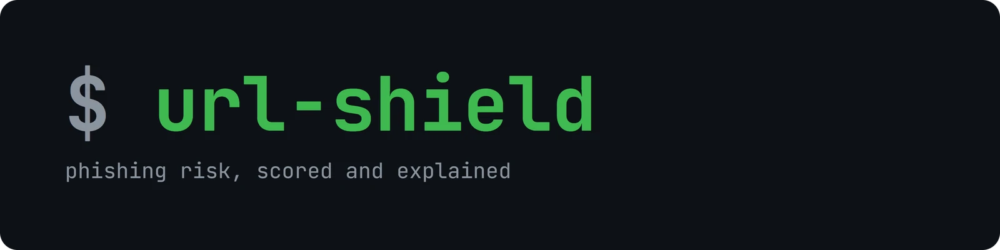
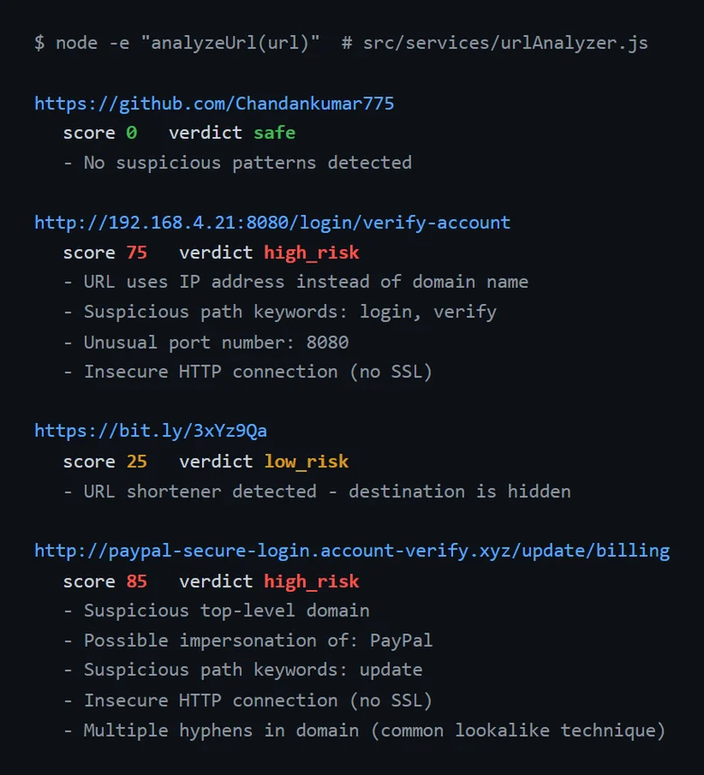

<div align="center">



**The backend for a phishing-link checker: send it a URL, get back a risk score, a verdict and the reasons.**



<sub>Real output of <code>analyzeUrl()</code> for four sample URLs.</sub>

</div>

## How a URL is scored

`src/services/urlAnalyzer.js` normalises the URL and adds points for each warning sign. The score is capped at 100:

| Signal | Points |
|---|---|
| IP address instead of a domain name | +35 |
| Looks like a known brand (impersonation) | +30 |
| URL shortener hides the destination | +25 |
| Suspicious top-level domain | +20 |
| Bait words in the path (login, verify, update, …) | +15 |
| Unusual port number | +15 |
| Too many subdomains | +10 |
| Plain HTTP, no SSL | +10 |
| Unusually long path | +10 |
| Several hyphens in the domain (lookalike trick) | +10 |

Verdict: under 20 is `safe`, under 50 `low_risk`, under 75 `medium_risk`, and 75 or more `high_risk`. Results are cached in memory for an hour.

## Endpoints

All routes are under `/v1`, rate-limited to 100 requests per 15 minutes per IP, and need an `x-api-key` header that matches `API_KEY`. Keys are compared in constant time.

| Method | Path | What it does |
|---|---|---|
| POST | `/v1/scan` | Scan a URL |
| GET | `/v1/scan/history` | Past scans |
| GET | `/v1/scan/:scanId` | One scan by id |
| GET | `/v1/reputation` | Domain reputation list |
| PUT | `/v1/reputation/:domain` | Mark a domain as trusted or blocked |
| POST | `/v1/feedback` | Report a wrong verdict |
| GET | `/v1/feedback/stats` | Feedback statistics |
| GET | `/v1/config` | Client configuration |
| PUT | `/v1/config/preferences/:deviceId` | Save a device's preferences |
| GET | `/health` | Health check |

## Run locally

Requires Node 18+ and, for history and reputation, MongoDB.

```bash
npm install
# set the variables below in a .env file
npm run dev              # nodemon, or: npm start
```

| Variable | Purpose |
|---|---|
| `MONGODB_URI` | MongoDB connection (default `mongodb://localhost:27017/urlshield`) |
| `API_KEY` | **required**: the key clients send in `x-api-key`. With no key set, authenticated routes return 503 |
| `NODE_ENV` | `development` allows requests without a key |

Deploys to Railway with `railway.toml` (Nixpacks build, `/health` health check).

## Project layout

```
src/
  index.js            Express app: helmet, CORS, rate limit, routes
  routes/             scan, reputation, feedback, config
  controllers/        request handlers
  services/           urlAnalyzer.js (scoring), URL expansion
  models/             Mongoose: ScanEvent, DomainProfile, Feedback, UserPreference
  middleware/         API-key auth, error handler
  utils/urlUtils.js   normalisation, shortener / TLD / brand / bait-word checks
```

## Tech stack

Node.js, Express, Mongoose (MongoDB), helmet, express-rate-limit, morgan.
